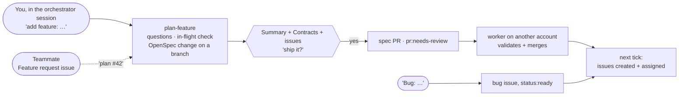

# Changing the plan mid-project

Scope changes all day. You change it by **talking to the orchestrator** while the workers keep building. The orchestrator's Copilot CLI session is the conductor's control seat (see [setup/conductor.md](setup/conductor.md#4-start-the-orchestrator)).

**To interrupt it:** press **Esc** in Copilot CLI (or the stop button in VS Code), type your request, and it goes back to its loop when it's done. Nothing pauses: assignments live in GitHub, so workers carry on.

| You say | What happens |
|---------|--------------|
| *"Add feature: search on the list page, p0"* | It plans the feature **with you** (`plan-feature`). It asks one round of questions, checks what's in flight, writes an OpenSpec change on a branch, and shows you the summary, the Contracts and the issues it would create. You say *"ship it"*. The spec PR goes to a worker on another account, which validates and merges it. The next tick creates the issues and assigns them |
| *"Bug: the save button does nothing on Safari"* | It creates a `type:bug` issue in the right lane, and the next tick assigns it |
| *"Make #23 p0"* / *"lower #31"* | It relabels the issue. New assignments follow the new priority, and work already underway isn't interrupted |
| *"Drop #31"* / *"cancel the export feature"* | It closes the issues as *not planned*, removes the unbuilt change in a small spec PR, and warns you first if someone is already on it |
| *"Pause"* / *"resume"* | It stops or restarts assigning work. Workers finish their current unit and then wait |
| *"What's happening?"* | A 5-line status |

**Teammates** can file ideas without interrupting anyone: the **Feature request** issue template on GitHub. Workers never pick these up. The orchestrator lists them as *waiting to be planned*, and you say *"plan #42"* when you want it in.

**Why it's safe to change the plan while everything runs:**
- Issues are only created from specs **merged on main**. A feature you're still planning, or that you abandon halfway, never reaches the board.
- Planning checks the files that in-progress issues touch, and makes the new groups wait (`depends=`) for any work they would collide with.
- A change to an existing Contract is shown to you explicitly before you approve, because it means rework for whoever builds on it.
- Workers may review and merge spec PRs, but never rewrite them. A spec PR that's sent back comes to you, through the orchestrator.

When every issue of a change is closed, the orchestrator opens an `[<change>] archive the change` issue (`agent:auto`). The worker that takes it runs `openspec archive <id> --yes`, which merges the change's spec deltas into `openspec/specs/`, so the next change builds on an up-to-date spec.
