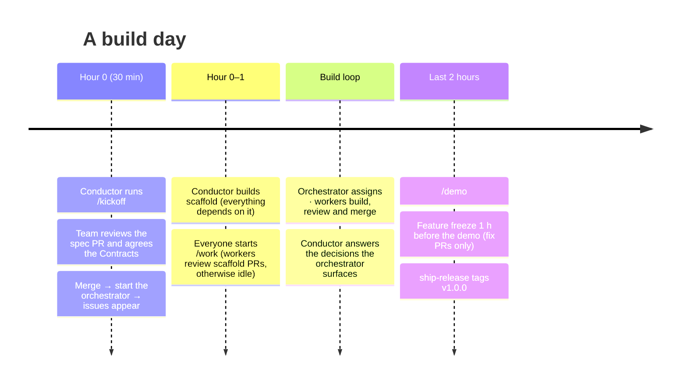

# Playbook

What the team does, hour by hour, once every machine is set up ([setup/](setup/README.md)).

## Hour 0: Kickoff (whole team, about 30 minutes)

1. The conductor runs, in VS Code Copilot Chat:
   > `/kickoff an AI study buddy for Spanish learners`

   The conductor asks for missing inputs, then uses **Product Owner** prioritization and an **Architect** initialization/feasibility review. It reconciles scope with the timebox before proposing the **must-haves** and optional **opportunities** for human approval. Priorities, assumptions, simulations and demo cutoffs are recorded in the OpenSpec artifacts. Reply with the numbers to include. Then it:
   - fills the project brief in `openspec/config.yaml`
   - creates a `scaffold` change, reserved for the conductor with `assignee=`, plus 4–8 vertical-slice changes for the must-haves and one per approved opportunity (p1/p2, so they can be cut without breaking the demo), each with a **Contracts** section in `design.md`
   - runs `openspec validate --all --strict` and previews the backlog with `node scripts/orchestrate.mjs sync --dry-run`
   - opens the spec PR `docs(spec): MVP spec and contracts`
2. **The whole team reviews the spec PR together**, mostly the `## Contracts` sections. This is the most important review of the day, because every worker will build against these shapes in parallel.
3. Merge it, then the conductor [starts the orchestrator](setup/conductor.md#4-start-the-orchestrator). Its first tick creates the issues, with their dependencies linked. The `scaffold` issues come out already assigned to the conductor.
4. The conductor builds `scaffold` interactively in VS Code (*"implement #<scaffold issue>"*): repo skeleton, the Install/Lint/Test/Build rows of the **Commands** table in `AGENTS.md` (which the `check` skill runs), hello world deployed. Everyone else starts their worker now. Every other issue depends on `scaffold`, so workers review scaffold PRs and otherwise wait until it merges. Then the whole board unblocks at once.

## During the build

- **Every ~45 minutes, glance at your workers.** If a chat has grown long, start a new chat and run `/work <lane>` again. A fresh context keeps it fast and focused, and its unfinished assignment comes back to it.
- **Conductor:** keep an eye on the orchestrator's terminal. It surfaces decisions workers parked (`status:needs-decision`), stuck workers, and an empty or fully blocked backlog, and it posts a short status every ~30 minutes. Answer decisions right there, or with `/decide` in VS Code.
- **New idea, bug or change of priority?** Tell the orchestrator. See [changing-the-plan.md](changing-the-plan.md).
- **Lanes running dry?** The orchestrator already moves idle workers into other lanes. If one lane has far more work, restart a worker on that lane, or add a worker for it ([worker.md → More than one worker on a machine](setup/worker.md#more-than-one-worker-on-a-machine)).

## Final 2 hours

For Wallet Grupo 1's approved 2026-10-23 12:30 Peru cutoff, use the reduced p0
scope in `openspec/config.yaml`: onboarding, login and own wallet only. The human
approved a local demo instead of public deployment; scaffold verifies local
start/build instructions. Contacts/payments/history are p1 after this cutoff.
Do not claim a public deployment or release readiness without the pinned
independent assessments below.

- `/demo` produces the README, `docs/DEMO.md`, a seed script, and a list of demo-path risks.
- At **every agreed demo cutoff**, not only the final one, use `/demo-cutoff <id>` with the conductor. External `tester` and `security` sessions assess the same pinned commit independently. Persist their reports and decision; failures, required checks not run, stale evidence and blocking findings prevent readiness. Setup: [quality-workers.md](quality-workers.md).
- Feature freeze 1 hour before the demo: only `fix:` PRs on the demo path get merged. Stop the workers once the board is empty, then the orchestrator.
- *"Cut the demo release"* (the `ship-release` skill) requires a passing final cutoff for the exact release candidate, tags v1.0.0, deploys, and smoke-tests.
